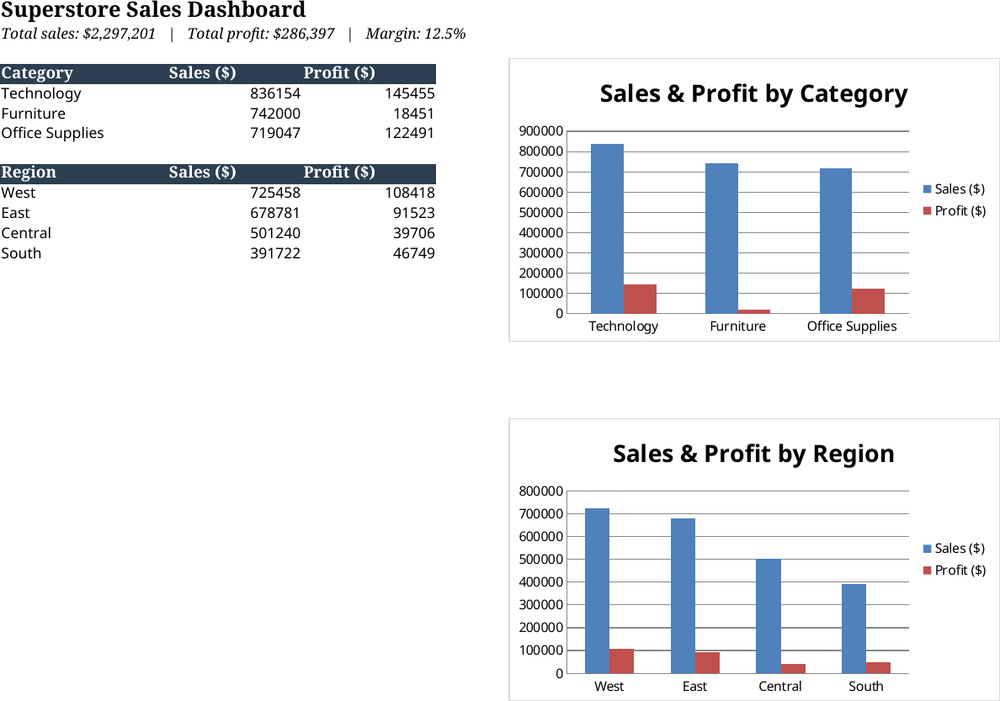

# Superstore Sales Performance Analysis

Where is this business actually making money, and where is it just moving volume?



## Key findings

- $2.3M in sales over 2014-2017, but only **$286K profit** — a thin **12.5%** margin, and it's not spread evenly.
- **Furniture sells almost as much as Technology** ($742K vs $836K) but makes a fraction of the profit ($18K vs $145K) — a margin problem, not a demand problem.
- Two sub-categories carry that entire problem: **Tables lose $17.7K** and **Bookcases lose $3.5K**. Everything else in Furniture is fine.
- Profit per order goes **negative past a 20% discount** and craters past 40% — the discount policy is losing money on a real share of orders.
- **Central region** has solid sales ($501K) but the weakest margin of any region (**7.9%**, vs 13-15% elsewhere).

## Method

- Checked overall sales/profit, then broke it down by category, sub-category, region, and discount level to find where margin falls apart.
- Wrote the same breakdowns as SQL (`sql/queries.sql`) — this is the kind of question that usually comes as "can you pull sales by region" from a SQL-backed BI tool, not a notebook.
- Built an Excel dashboard summarizing category and region performance (`dashboard/`).

## How to run

```bash
pip install -r requirements.txt
jupyter notebook notebooks/analysis.ipynb
```

For the SQL version:

```bash
sqlite3 superstore.db
.mode csv
.import data/Sample-Superstore.csv orders
.read sql/queries.sql
```

## Recommendations

1. Revisit pricing/discounting on Tables and Bookcases — they're being sold at a loss.
2. Cap discounts at ~20%, especially in Furniture, where the margin damage is worst.
3. Dig into why Central region's margin lags the others despite decent sales volume — likely a discounting pattern specific to that region.

## Data source

[Sample Superstore](https://www.kaggle.com/datasets/vivek468/superstore-dataset-final) (Kaggle) — 9,994 orders, 21 columns.
